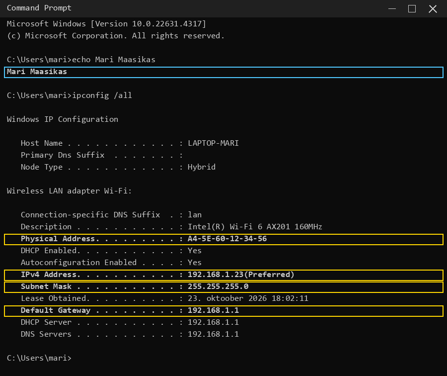
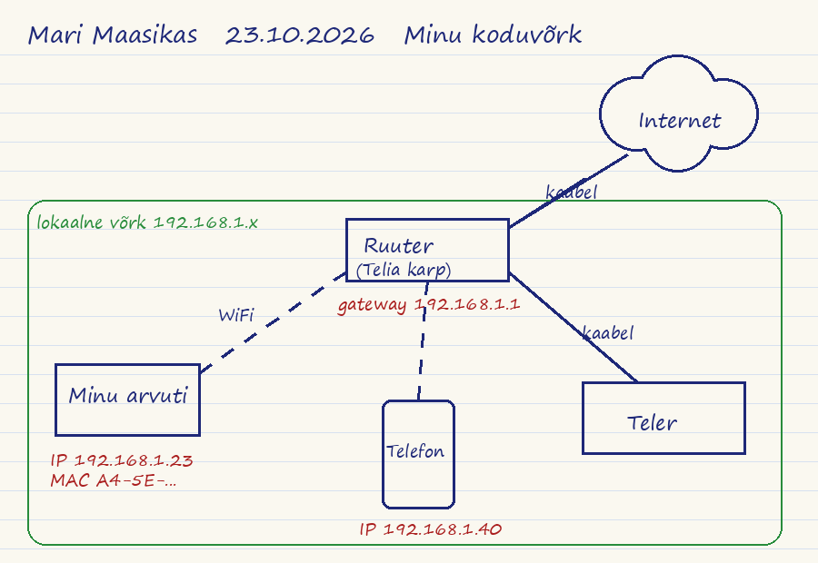

# Kodutöö 06 — Minu koduvõrk

**Sinu nimi:** _______________________

Tunnis rääkisime kahest kihist:

- **2. kiht:** MAC-aadress, kommutaator (switch), lokaalne võrk, kaader (frame)
- **3. kiht:** IP-aadress, ruuter (router), IP-pakett, mitu võrku, default gateway

Selles kodutöös leiad need asjad **oma kodu võrgust**. Iga õpilase vastused on erinevad, sest igaühel on oma arvuti ja oma kodu.

📖 Kui midagi ei mäleta, loe [Peatükk 4: Andmesidekiht](https://optalvik.github.io/avalused/teooria/04_andmesidekiht.html) (2. kiht) ja [Peatükk 6: Võrgukiht](https://optalvik.github.io/avalused/teooria/06_vorgukiht.html), osad „Ruuter — võrkude vaheline teejuht" ja „Default gateway" (3. kiht).

Failid laed üles nii: **Add file → Upload files**, lohista failid, vajuta **Commit changes**. README täitmiseks vajuta pliiatsit (✏️ Edit).

## Vali oma olukord (loe kõigepealt!)

Kõigil on sama töö: **3 faili + 8 vastust**. Erineb ainult see, mida pildistad.

| Sinu olukord | `ipconfig.png` | `ruuter.jpg` | Joonisel on ruuter |
|---|---|---|---|
| **A. Kodus on ruuter / WiFi-karp** (Telia, Elisa vms) | kodus, oma arvutis | ruuteri kleebis (WiFi parool kinni kaetud) | kodu ruuter |
| **B. Internet tuleb telefonist** (hotspot, levijagamine) | arvutis, kui on telefoni hotspot'iga ühendatud | ekraanipilt telefoni seadetest, kus levijagamine on sees (Android: Seaded → Ühendused → Mobiilne kuumkoht; iPhone: Settings → Personal Hotspot) | sinu telefon |
| **C. Ühiselamu WiFi** | ühiselamus, oma arvutis | pilt WiFi-saatjast seinal või laes; kui seda ei näe, ekraanipilt WiFi nimest arvutis | ühiselamu ruuter (kirjuta küsimusse 1, et see on ühiselamu oma) |
| **D. Kodus pole internetti** | koolis, kooli arvutis või oma sülearvutis kooli võrgus | pilt klassi võrgupesast seinal või kommutaatorist; küsi õpetajalt, kus on kooli ruuter | kooli ruuter (kirjuta küsimusse 1, et see on kooli oma) |

Default gateway leiad igal juhul samamoodi: `ipconfig /all` (osa 1).


---

## 1. Sinu arvuti aadressid → `ipconfig.png`

Ühenda arvuti WiFi või kaabliga võrku (kodus, ühiselamus või koolis, vt tabelit). Ava **Command Prompt** (Start → kirjuta `cmd` → Enter) ja kirjuta:

```
ipconfig /all
```

**Enne `ipconfig`-i kirjuta samasse aknasse oma nimi**, et oleks näha, et see on sinu arvuti:

```
echo Mari Maasikas
ipconfig /all
```

Otsi välja see adapter, millega oled võrgus. WiFi puhul on see **Wireless LAN adapter Wi-Fi**, kaabli puhul **Ethernet adapter Ethernet**. Kui adaptereid on mitu (näiteks VPN või vEthernet), vali see, mille all on **Default Gateway** täidetud.

Selle adapteri all leia neli rida: **Physical Address**, **IPv4 Address**, **Subnet Mask**, **Default Gateway**. Mida need tähendavad, uurid allpool ise.

**Näide, milline ekraanipilt peab olema** (nimi on sinine, otsitavad read kollased):



Tee ekraanipilt **kogu aknast**: **Win + Shift + S** → vali ülevalt **Window mode** (akna režiim) → klõpsa käsuaknale. Pildil peavad olema näha sinu nimi ja kõik neli rida. Kui aken on liiga väike, tee see enne suuremaks. Ära lõika pilti väiksemaks ja ära pildista ekraani telefoniga. Salvesta nimega `ipconfig.png`.

💡 **Kui sul on Mac või Linux:**

- **Mac:** System Settings → Network → Wi-Fi → Details. Seal on IP address, Router (see on default gateway) ja Hardware → MAC address.
- **Linux:** terminalis `ip a` (MAC on `link/ether` real, IP on `inet` real) ja `ip route` (gateway on `default via` järel).

💡 Kui adapteri all on Default Gateway tühi, siis see adapter ei ole võrgus. Otsi järgmine adapter.

### Uuri, mida käsk teeb

Igal Windowsi käsul on sisseehitatud abi. Kirjuta käsu järele `/?`:

```
ipconfig /?
```

Abi näitab, mida käsk teeb ja mis võtmed (`/all`, `/release`, `/renew` jne) sellel on. Sama käib iga käsu kohta, näiteks `ping /?`. Nii saad käsu kohta teada ilma Google'ita.

**A. Mida teeb käsk `ipconfig` ja mida lisab võti `/all`? Kirjuta oma sõnadega abi põhjal.**

> ...

**B. Täida tabel oma `ipconfig /all` väljundi järgi.** Kirjuta `...` asemele. Kui ei tea, mis rida tähendab, vaata vihjet tabeli all.

| Rida ipconfig'is | Sinu väärtus | Mis see on ja milleks seda vaja on? | Kiht (2 või 3) |
|---|---|---|---|
| Physical Address | ... | ... | ... |
| IPv4 Address | ... | ... | ... |
| Subnet Mask | ... | ... | ... |
| Default Gateway | ... | ... | ... |

📖 **Kust vastused leiad:** õpikus, mitte siit.

- Physical Address: [Peatükk 4, „MAC-aadress — seadme isikukood"](https://optalvik.github.io/avalused/teooria/04_andmesidekiht.html#mac-aadress-seadme-isikukood) ja [„MAC vs IP-aadress"](https://optalvik.github.io/avalused/teooria/04_andmesidekiht.html#mac-vs-ip-aadress)
- IPv4 Address: [Peatükk 4, „MAC vs IP-aadress"](https://optalvik.github.io/avalused/teooria/04_andmesidekiht.html#mac-vs-ip-aadress) ja [Peatükk 6, „Ruuter"](https://optalvik.github.io/avalused/teooria/06_vorgukiht.html#ruuter-vorkude-vaheline-teejuht)
- Subnet Mask ja Default Gateway: [Peatükk 6, „Default gateway"](https://optalvik.github.io/avalused/teooria/06_vorgukiht.html#default-gateway-uks-valismaailma). Seal on sama väljund näitena.

**C. Võrdle oma IPv4-aadressi ja Default Gateway't. Mis neil on sama ja miks?**

> ...

## 2. Sinu ruuter → `ruuter.jpg`

Default gateway on kodus üks konkreetne seade. Tavaliselt on see Telia, Elisa või muu teenusepakkuja karp, mille küljes on kaablid ja tulukesed. Leia see ja pildista **kleebist**. Kleebis on tavaliselt karbi all või taga ja sellel on mudel, MAC-aadress või S/N.

**Pildil peab olema:**

- kleebis nii, et mudeli nimi on loetav (pildista lähedalt ja valges, ilma välguta, et ei peegelduks)
- paberitükk, millele oled kirjutanud **oma nime ja tänase kuupäeva**, ruuteri kõrval samal pildil

Kui kleebis ja nimesilt ühele pildile ei mahu, tee kaks pilti: `ruuter.jpg` (kogu karp koos nimesildiga) ja `ruuter2.jpg` (kleebis lähedalt).

⚠️ **Kata kinni WiFi parool** (näpu või paberiga), kui see on kleebisel. Parool ei tohi pildile jääda.

Kui sul on olukord B, C või D, tee pilt nii, nagu on kirjas tabelis „Vali oma olukord" lehe alguses.

## 3. Joonis käsitsi → `joonis.jpg`

Joonista **paberile pliiatsiga** (mitte arvutis) oma koduvõrk:

- sinu arvuti, telefon ja teised seadmed, mis on kodus võrgus
- ruuter (või telefon, kui kasutad hotspot'i)
- internet (pilv)
- jooned seadmete vahel; WiFi puhul katkendjoon

Kirjuta joonisele oma arvuti **IP-aadress** ja ruuteri **IP-aadress** (default gateway) ülesande 1 pildilt. Kirjuta lehe ülaserva **oma nimi**.

Pildista **kogu leht** ülevalt, valges ruumis, nii et kõik kirjad on loetavad. Salvesta `joonis.jpg`.

**Näide** (sinu joonis on käsitsi ja sinu aadressidega):



💡 Vihje: kõik seadmed, mis on ühendatud sama ruuteriga, on üks **lokaalne võrk**. Internet on **teine võrk**. Ruuter on nende kahe vahel.

## 4. Loe ruuteri juhendit

Iga seadme kohta on tootjal **juhend** (*user manual*) ja **andmeleht** (*datasheet*, *specifications*). Võrguspetsialist ei õpi neid pähe, vaid oskab sealt kiiresti õige rea üles leida. Seda harjutad nüüd.

**Mis seadme juhendit loed?**

- **Olukord A:** sinu oma ruuter. Mudel on kleebisel (`ruuter.jpg`).
- **Olukord B, C, D:** MikroTik hAP ax². See on levinud koduruuter, mille juhend on veebis vabalt loetav.

**Kuidas juhendi leiad:**

1. Otsi Google'ist `<mudel> user manual` või `<mudel> datasheet`, näiteks `MikroTik hAP ax2 user manual`.
2. Ava **tootja enda leht** (mikrotik.com, tp-link.com, asus.com jne), mitte poe või foorumi leht. Teenusepakkuja karbi juhend on teenusepakkuja abilehel (Telia, Elisa).
3. Juhend on pikk, seepärast ära loe seda algusest lõpuni. Vajuta **Ctrl+F** ja otsi märksõnu: `192.168`, `default`, `reset`, `password`, `Ethernet`.

💡 MikroTik hAP ax² juhend: <https://help.mikrotik.com/docs/display/UM/hAP+ax%C2%B2>. Seal otsi Ctrl+F-ga sõnu `192.168` ja `reset button`.

## 5. Milline ruuter osta?

Sa töötad IT-toes ja klient küsib, millise ruuteri ta peaks ostma. Klient ütleb, mida ruuter **peab toetama**. Sinu töö on leida tootelehtedelt (*Specifications*) õige mudel ja tõestada valikut tootelehe ridadega.

**Sinu klient sõltub sinu eesnime esitähest:**

| Eesnime esitäht | Klient | Ruuter peab toetama |
|---|---|---|
| A–E | **1. Pere kodu** | WiFi 6 (802.11ax) ka **5 GHz** sagedusel; vähemalt 4 juhtmega gigabit-porti; kõige odavam, mis sobib |
| F–J | **2. Väike kontor** | internet tuleb valguskaabliga, seega on vaja **SFP-porti**; vähemalt 5 gigabit-porti; WiFi-d pole vaja (kontoris on eraldi WiFi-saatjad) |
| K–M | **3. Kodukontor** | **2,5 Gbit/s** port kiire interneti jaoks; **USB 3** port kõvaketta jaoks; WiFi 6 |
| N–R | **4. Suvila** | WiFi 6; kasutab ainult telefon ja sülearvuti, seega piisab **2,4 GHz** sagedusest; **kõige odavam** |
| S–Ü (ka Õ, Ä, Ö) | **5. Maamaja** | **USB-port** 4G modemi jaoks (varuinternet); WiFi ka **5 GHz** sagedusel; kõige odavam, mis sobib |

**Valikus on 5 MikroTiki ruuterit.** Ava iga tooteleht ja vaata osa **Specifications**:

| Mudel | Tooteleht |
|---|---|
| hAP ax lite | <https://mikrotik.com/product/hap_ax_lite> |
| hAP ac² | <https://mikrotik.com/product/hap_ac2> |
| hAP ax² | <https://mikrotik.com/product/hap_ax2> |
| hAP ax³ | <https://mikrotik.com/product/hap_ax3> |
| hEX S | <https://mikrotik.com/product/hex_s> |

💡 Vihjed, mis rida tootelehel otsida:

- juhtmega pordid: `10/100/1000 Ethernet ports`, `Number of 2.5G Ethernet ports`, `SFP ports`
- WiFi: `Wireless 2.4 GHz standards`, `Wireless 5 GHz standards`. Kui 5 GHz rida puudub, siis 5 GHz sagedust see seade ei toeta. `ax` = WiFi 6, `ac` = WiFi 5
- USB: `Number of USB ports`, `USB slot type`
- hind: `Suggested price` (tootja soovitushind dollarites)

## 6. Küsimused (vasta oma andmetega, 1–3 lauset)

**1. Mis on sinu default gateway IP-aadress ja mis seade see sinu kodus on?**

> ...

**2. Kas sinu arvuti ja telefon on samas lokaalses võrgus? Kuidas sa seda tead?**

> ...

💡 Vihje: telefonis näed IP-aadressi WiFi seadetes (vajuta võrgu nimel). Kui IP-aadressi kolm esimest numbrit on samad kui arvutil, nt `192.168.1.x`, ja gateway on sama, siis on nad samas võrgus.

**3. Sinu arvutil on MAC-aadress ja IP-aadress. Kumb on 2. kihi ja kumb 3. kihi aadress? Kumba kasutab ruuter, kui pakett läheb internetti?**

> ...

**4. Mis ruuteri juhendit sa lugesid (mudel)? Pane link juhendile.**

> ...

**5. Mis aadressil avaneb juhendi järgi ruuteri seadistusleht ja mis on vaikimisi kasutajanimi? Kas see aadress on sama mis sinu default gateway? Kui ei ole, siis miks võib see erineda?**

> ...

**6. Kuidas taastada ruuteri tehaseseaded (reset)? Kirjuta sammud juhendi järgi.**

> ...

**7. Mis number on sinu klient ja millise ruuteri sa valid? Kirjuta iga nõude kohta rida tootelehelt, mis seda tõestab (nt `10/100/1000 Ethernet ports = 5`), ja hind.**

> ...

**8. Vali tabelist üks teine mudel. Millise nõude järgi see sinu kliendile ei sobi? Too tootelehe rida.**

> ...

---

## ✅ Kontrolli enne, kui lõpetad

- [ ] Nimi kirjas
- [ ] `ipconfig.png`: näha IPv4, MAC ja Default Gateway
- [ ] `ruuter.jpg`: kleebis, WiFi parool kinni kaetud (või hotspot / kooli WiFi)
- [ ] `joonis.jpg`: käsitsi joonistatud, IP-aadressid peal
- [ ] Osa 1 tabel ja küsimused A, C täidetud
- [ ] Kõik 8 vastust kirjas, `...` ei ole enam alles
- [ ] Vastuses 4 on link juhendile, vastuses 7 on valitud mudel ja tootelehe read

Järgmise tunni alguses seletad oma joonise järgi, kuidas pakett sinu arvutist internetti läheb. Võta joonis kaasa.
